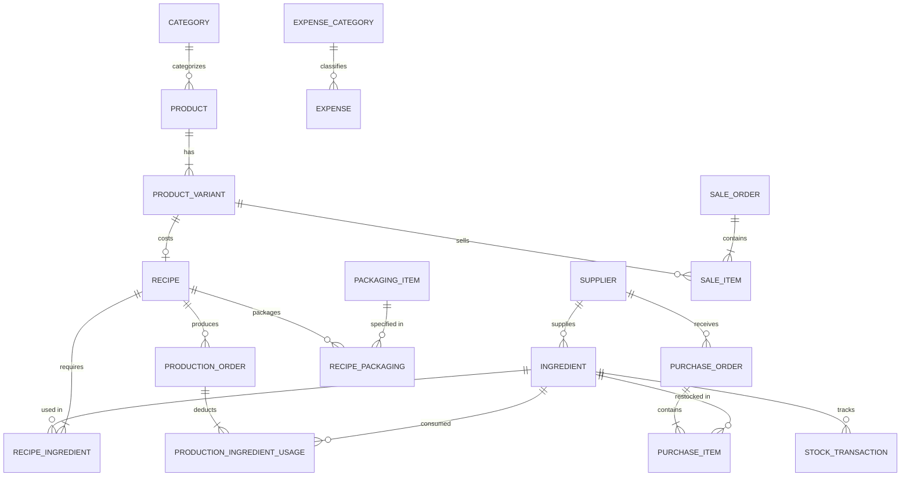

# CRAVEABLES Database Architecture & PostgreSQL Setup Guide

## 1. Relational Database Architecture

The CRAVEABLES Business Management System utilizes a normalized relational schema designed for business integrity, real-time inventory monitoring, and accounting separation.



---

## 2. PostgreSQL Configuration

The application is fully configured for PostgreSQL using `psycopg2-binary` and Django's PostgreSQL engine.

### Environment Configuration (`backend/.env`)

To connect to an active PostgreSQL database, set:

```ini
DJANGO_SECRET_KEY=craveables-secret-key-production-ready-2026
DJANGO_DEBUG=False
ALLOWED_HOSTS=*

# Database Connection
DB_ENGINE=postgresql
DB_NAME=craveables_db
DB_USER=postgres
DB_PASSWORD=your_secure_password
DB_HOST=localhost
DB_PORT=5432
```

### PostgreSQL Database Creation

Run the following SQL commands in PostgreSQL (via `psql` or pgAdmin):

```sql
CREATE DATABASE craveables_db;
CREATE USER craveables_user WITH PASSWORD 'your_secure_password';
ALTER ROLE craveables_user SET client_encoding TO 'utf8';
ALTER ROLE craveables_user SET default_transaction_isolation TO 'read committed';
ALTER ROLE craveables_user SET timezone TO 'Asia/Manila';
GRANT ALL PRIVILEGES ON DATABASE craveables_db TO craveables_user;
```

Then run migrations:

```bash
cd backend
python manage.py migrate
python manage.py import_excel_data
```

---

## 3. Docker Compose for PostgreSQL

For containerized PostgreSQL deployment, use `docker-compose.yml`:

```yaml
version: '3.8'

services:
  db:
    image: postgres:16-alpine
    container_name: craveables_postgres
    restart: always
    environment:
      POSTGRES_DB: craveables_db
      POSTGRES_USER: postgres
      POSTGRES_PASSWORD: postgrespassword
    ports:
      - "5432:5432"
    volumes:
      - postgres_data:/var/lib/postgresql/data

volumes:
  postgres_data:
```

---

## 4. Automatic Development Fallback

If PostgreSQL is not running locally, the application automatically uses an optimized SQLite database (`backend/db.sqlite3`), allowing zero-configuration local runs, automated tests, and offline development without breaking dependencies.

